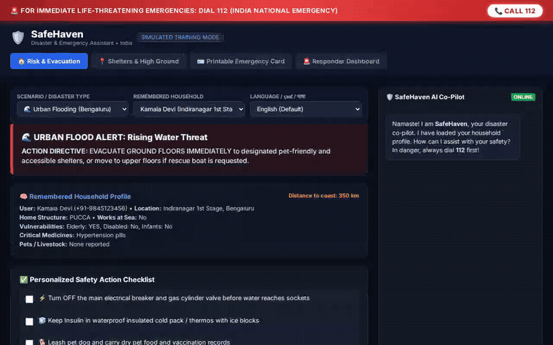

# SafeHaven: India Disaster & Emergency Co-Pilot

An agentic emergency assistant designed for disaster resilience across India (covering urban flooding in Bengaluru, coastal cyclones, storm surges, tsunamis in coastal Karnataka/Udupi, and severe heatwaves).

SafeHaven evaluates household vulnerability profiles, delivers immediate life-saving directives (English, Kannada, Hindi), connects citizens to verified shelters and high ground, registers SOS dispatches with responder teams, and formats printable emergency passes.

---

## Interactive Demo



---

## What SafeHaven Actually Does

- **Disaster Risk Directives & Action Checklists**:
  - Evaluates active disaster scenarios (*Urban Floods, Heatwaves, Cyclones, Storm Surges, Tsunamis*) against household vulnerability factors.
  - Generates deterministic life-saving action rules (e.g., safeguarding insulin cold chains above flood waters, disconnecting main power breakers, high-ground evacuation, hydration for solitary elderly).
- **Proximity-Ranked Shelters & Safe Locations**:
  - Queries local safe centers, hospitals, and high-ground ridges with capacity and elevation tracking.
  - Filters by wheelchair accessibility, pet-friendly holding, and medical cold chains.
- **Citizen SOS & District Responder Triage**:
  - Allows citizens to signal *"I Am Safe"* or *"I Need Help"* (SOS).
  - Automatically routes users to verified shelter solutions upon requesting help.
  - Logs distress requests into the **District Emergency Responder Console (SDRF/NDRF)** with severity triage (`CRITICAL_LIFE_THREAT` vs `HIGH`).
- **Emergency Identity Pass & Printable Certificate**:
  - Formats an official Disaster Emergency Pass Certificate complete with gold seal, medication alerts, emergency contacts, and 24/7 **112 National Helpline** badges.
  - Supports one-click browser PDF printing and waterproof wallet pouch sizing.
- **Multilingual Emergency Co-Pilot**:
  - Interactive triage chat supporting **English**, **ಕನ್ನಡ (Kannada)**, and **हिन्दी (Hindi)**.

---

## Wired Google Cloud Services & Tools

Based strictly on the code implemented in `app/`:

| Capability / Service | Implementation Status | Technical Details |
| :--- | :--- | :--- |
| **Google GenAI / Gemini 2.5 Flash** | **Wired & Active** | Powers interactive conversational triage in English, Kannada, and Hindi (`app/agent.py`, `frontend/server.py`). |
| **Vertex AI Imagen 3** | **Wired** | Evacuation route map graphic generation via `imagen-3.0-generate-002` (`app/tools.py`). |
| **ADK (Agent Development Kit)** | **Wired** | `google.adk.agents.Agent` with function tools for alerts, shelters, SOS triage, and emergency cards (`app/agent.py`). |
| **SQLite Emergency Database** | **Wired & Active** | Local relational store for households, alerts, safe locations, rescue requests, and fishing vessel tracking (`app/database.py`). |
| **FastAPI & Static UI Engine** | **Wired & Active** | Real-time REST endpoints and responsive emergency console on port 8089 (`frontend/server.py`, `frontend/static/index.html`). |

### Planned / Not Yet Implemented
- **Vertex AI Memory Bank**: *Planned* — Currently uses persistent SQLite relational tables (`households` table) for cross-session household memory.
- **Google Cloud Storage (GCS)**: *Planned* — Generated maps and printable cards are currently stored in local persistent directories.
- **Firestore**: *Planned* — Uses SQLite for local responder dispatch tracking.
- **A2UI Protocol**: *Planned* — Currently renders via native high-contrast HTML/CSS certificate components.

---

## Local Setup & Run Instructions

### Prerequisites
- Python 3.10+
- Google Cloud Project with Vertex AI API enabled (if using GenAI / Imagen features)

### 1. Install Dependencies
```bash
pip install fastapi uvicorn google-genai google-adk pydantic
```

### 2. Initialize Seed Data
Populate the simulated emergency dataset for Bengaluru Urban and Udupi Coast:
```bash
cd safehaven
PYTHONPATH=. python3 app/seed_data.py
```

### 3. Launch the Application
Start the SafeHaven emergency server:
```bash
PYTHONPATH=. python3 frontend/server.py
```

Open your browser and navigate to the local host at port `8089`.

---

## Emergency Hotline Notice
SafeHaven prominently integrates India's **National Emergency Helpline: 112** on all screens. In any real-world life-threatening situation, citizens must always contact 112 first.
